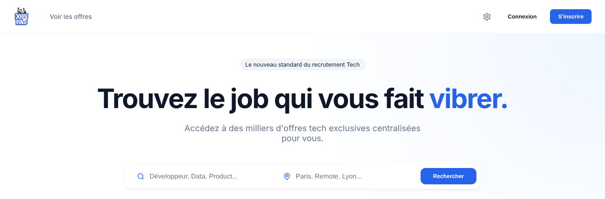
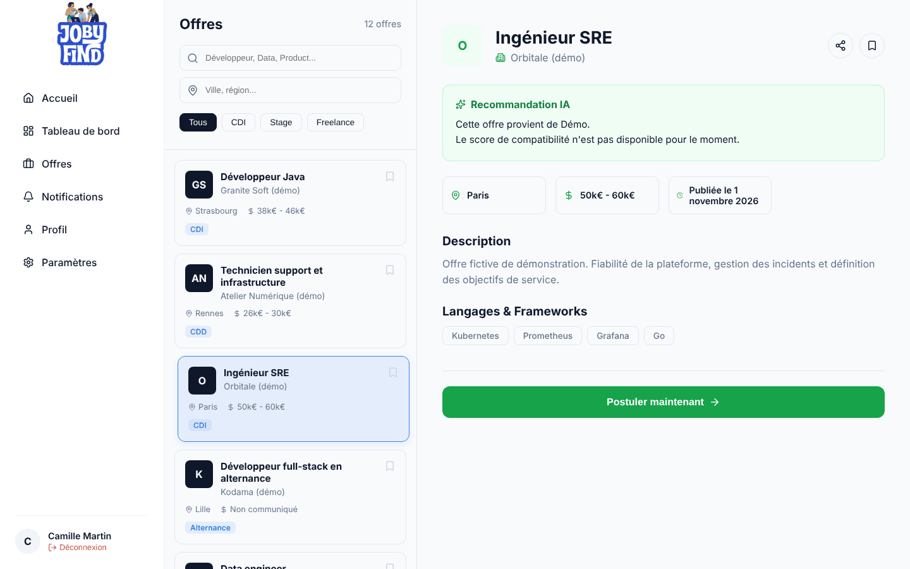
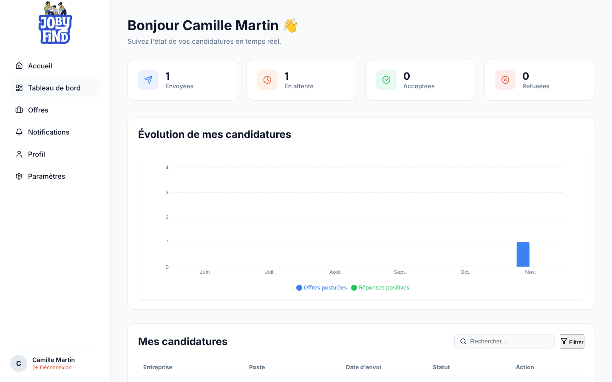
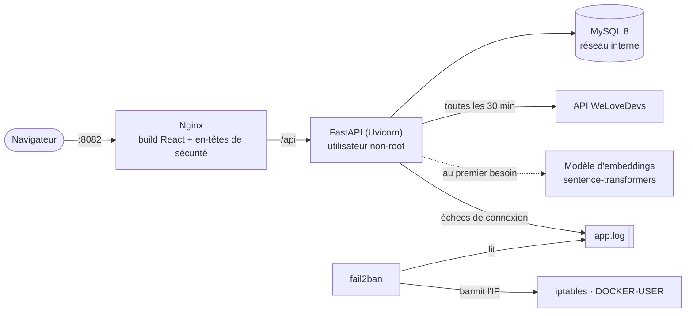

# JobyFind — agrégateur d'offres d'emploi tech

[](https://github.com/Lois5959/job-aggregator/actions/workflows/ci.yml)


JobyFind collecte automatiquement des offres d'emploi tech (API WeLoveDevs), les nettoie, les stocke
dans MySQL et les présente dans une application React : recherche et carte des offres, candidature
avec CV, tableau de bord de suivi, **recommandations par IA** selon les compétences du profil,
et espace d'administration.

Toute la stack démarre avec **une seule commande Docker Compose**, avec healthchecks, réseau isolé
pour la base, protection contre la force brute (API + fail2ban) et une CI GitHub Actions qui
vérifie le code **et** le démarrage complet des conteneurs.



| Offres | Tableau de bord |
|---|---|
|  |  |

---

## Démarrage rapide

Prérequis : **Docker** avec **Docker Compose v2**.

```bash
git clone https://github.com/Lois5959/job-aggregator.git
cd job-aggregator
cp .env.example .env      # facultatif : sans .env, des valeurs de développement sont utilisées
docker compose up --build
```

Puis ouvrir **http://localhost:8082**.

- Avec le `.env` d'exemple, un compte admin est créé : `admin@example.com` / `change-me-admin`.
- Sans clé WeLoveDevs, **12 offres de démonstration** sont chargées : l'application est utilisable tout de suite.
- Le premier build est long (PyTorch CPU). Au premier démarrage, le modèle d'IA (~470 Mo) se
  télécharge en arrière-plan ; mettre `WARMUP_MODEL=false` pour le charger seulement au premier besoin.

| Service | Adresse | Remarque |
|---|---|---|
| Application | http://localhost:8082 | Nginx : front React + proxy `/api` |
| API (Swagger) | http://127.0.0.1:8000/docs | Machine locale uniquement |
| phpMyAdmin | http://127.0.0.1:8081 | `docker compose --profile tools up` |
| fail2ban | — | `docker compose --profile security up` (Linux) |

Arrêter : `docker compose down` (ajouter `-v` pour effacer aussi la base).

---

## Fonctionnalités

- **Collecte automatique** des offres WeLoveDevs toutes les 30 min (tâche de fond FastAPI),
  normalisation (dates, lieux, salaires, compétences), suppression du HTML, pas de doublons.
- **Recherche** par mot-clé, ville et type de contrat, et **carte** des offres (Leaflet).
- **Recommandations IA** : les offres sont classées selon la proximité sémantique entre les
  compétences du profil et l'offre (`sentence-transformers`, modèle multilingue). Les vecteurs
  des offres sont mis en cache ; si le modèle n'est pas disponible, l'API renvoie la liste normale.
- **Candidatures** avec CV et lettre (PDF / DOC / DOCX / ODT, 5 Mo max) et **tableau de bord**
  avec l'évolution sur 6 mois.
- **Administration** : gestion des utilisateurs et des offres, collecte manuelle.
- Interface en 6 langues, thème clair / sombre, options d'accessibilité.

---

## Architecture



- `frontend` ne démarre que lorsque `backend` est sain, qui attend lui-même `db`
  (`depends_on: condition: service_healthy`).
- `backend_network` est `internal: true` : la base n'a aucun accès à Internet.
- Seul Nginx est publié sur toutes les interfaces ; l'API et phpMyAdmin sont liés à `127.0.0.1`.

| Couche | Technologies |
|---|---|
| Front | React 19, TypeScript, Vite, Recharts, Leaflet, ESLint |
| API | FastAPI, Pydantic, python-jose (JWT), passlib/bcrypt, mysql-connector |
| IA | sentence-transformers, PyTorch CPU |
| Données | MySQL 8.0 (schéma dans `db/init.sql`) |
| Infra | Docker (multi-stage, non-root, healthchecks), Docker Compose (profils), Nginx, fail2ban |
| Qualité | pytest, flake8, GitHub Actions |

---

## Sécurité

| Menace | Contrôle |
|---|---|
| Accès aux données d'un autre utilisateur | JWT obligatoire + vérification « propriétaire ou admin » sur chaque route |
| Élévation de privilèges | Rôle admin **relu en base** à chaque appel ; impossible de s'inscrire admin |
| Force brute | 5 échecs / 10 min par IP → `429`, puis bannissement réseau par fail2ban |
| Usurpation d'IP | Nginx écrase `X-Forwarded-For` (le client ne peut pas choisir son IP) |
| Injection SQL | Requêtes 100 % paramétrées + validation Pydantic |
| XSS | HTML retiré des descriptions à la collecte, affichage en texte, Content-Security-Policy |
| Secrets | Variables d'environnement, `.env` jamais versionné, aucun compte par défaut dans le code |

Détails, choix et limites : [docs/security/security-choices.md](docs/security/security-choices.md).

---

## Tests et qualité

```bash
# Backend : 68 tests sans base ni modèle (fausse base en mémoire, faux modèle d'IA)
cd backend
pip install -r requirements-dev.txt
flake8 .
pytest --cov=.

# + 6 tests d'intégration sur un vrai MySQL
RUN_DB_TESTS=1 DB_HOST=127.0.0.1 MYSQL_USER=... MYSQL_PASSWORD=... MYSQL_DATABASE=... pytest -m integration

# Frontend
cd front-end
npm ci && npm run lint && npm run typecheck && npm run build
```

Les tests couvrent notamment : inscription / connexion, blocage après 5 échecs, ligne écrite pour
fail2ban, refus `401` / `403` sur les routes protégées (y compris un jeton qui se prétend admin),
normalisation des offres WeLoveDevs, nettoyage du HTML, classement et cache des recommandations,
statistiques mensuelles sur un changement d'année.

### Intégration continue

[`.github/workflows/ci.yml`](.github/workflows/ci.yml), sur chaque push et pull request :

| Job | Vérifie |
|---|---|
| `backend` | flake8 + pytest avec couverture |
| `integration` | requêtes SQL réelles sur un service MySQL 8 |
| `frontend` | ESLint, `tsc`, build Vite |
| `docker` | `docker compose up --wait` : tous les healthchecks passent, puis tests de fumée à travers Nginx (inscription, connexion, route protégée, admin refusé) |

---

## Configuration

Toutes les variables sont décrites dans [`.env.example`](.env.example).

| Variable | Rôle | Défaut |
|---|---|---|
| `MYSQL_*` | Identifiants de la base | valeurs de développement |
| `JWT_SECRET` | Clé de signature des jetons (`openssl rand -base64 48`) | aléatoire à chaque démarrage |
| `JWT_EXPIRE_MINUTES` | Durée d'une session | `30` |
| `ADMIN_EMAIL` / `ADMIN_PASSWORD` | Compte admin créé au démarrage | aucun |
| `WELOVEDEVS_API_KEY` | Active la collecte réelle | vide → offres de démo |
| `COLLECT_INTERVAL_MINUTES` | Fréquence de collecte | `30` |
| `DEMO_DATA` | `auto` ou `never` | `auto` |
| `WARMUP_MODEL` | Charger le modèle d'IA dès le démarrage | `true` |
| `LOGIN_MAX_ATTEMPTS` / `LOGIN_WINDOW_SECONDS` | Limite de tentatives de connexion | `5` / `600` |
| `CORS_ORIGINS` | Origines autorisées | `http://localhost:8082` |

---

## Développement du front

Avec la stack lancée par Docker, le serveur Vite relaie `/api` vers `127.0.0.1:8000` :

```bash
cd front-end
npm ci
npm run dev        # http://localhost:5173
```

---

## Structure du projet

```
.
├── backend/
│   ├── api.py              # application FastAPI : démarrage, routes offres / profil / candidatures / admin
│   ├── routes.py           # inscription et connexion
│   ├── auth.py             # JWT, bcrypt, contrôle d'accès, limite de tentatives
│   ├── collector.py        # collecte WeLoveDevs et normalisation des offres
│   ├── database_api.py     # requêtes SQL paramétrées
│   ├── feature_ia.py       # recommandations (embeddings + cache)
│   ├── demo_offers.json    # offres fictives quand la collecte est désactivée
│   └── tests/              # pytest (unitaires + intégration MySQL)
├── front-end/
│   ├── src/lib/            # client API (jeton, erreurs) et types partagés
│   ├── src/pages/          # pages React
│   ├── nginx.conf          # proxy /api, cache, en-têtes de sécurité
│   └── Dockerfile          # build Node puis Nginx
├── db/init.sql             # schéma MySQL
├── fail2ban/               # filtre et jail
├── docs/                   # ADR, API, schéma de base, sécurité, produit
├── docker-compose.yml
└── .github/workflows/ci.yml
```

## Documentation

- [Documentation de l'API](docs/doc-tech/api-documentation.md)
- [Schéma de la base](docs/doc-tech/database-schema.md)
- [Choix de sécurité](docs/security/security-choices.md)
- Décisions d'architecture : [ADR-001 à ADR-006](docs/adr/)

---

## Contexte et équipe

Projet réalisé en équipe en 2ᵉ année du Bachelor Epitech (module B-YEP-200, Lille).

- **Loïs-Elie Ekollo** — _à compléter : ta partie du projet_
- _Coéquipiers à créditer_

**Après le rendu**, j'ai repris le projet pour le rendre déployable et sûr : contrôle d'accès sur
toutes les routes, limite de tentatives de connexion et fail2ban fonctionnel, healthchecks et
réseau interne dans Docker Compose, offres de démo pour un démarrage sans clé d'API,
suppression du HTML des descriptions, 74 tests automatisés et une CI en quatre jobs.
